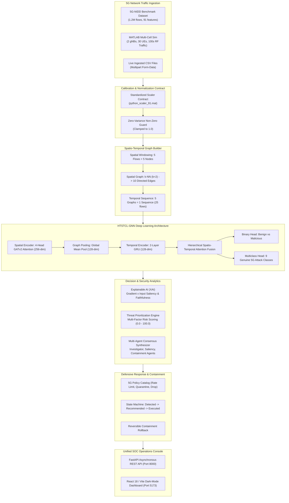
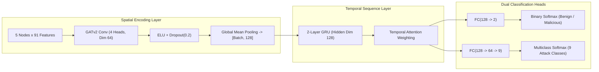

# Explainable Hierarchical Temporal Graph Neural Network for Early Intrusion Detection in 5G Wireless Networks

[](https://www.python.org/)
[](https://pytorch.org/)
[](https://pyg.org/)
[](https://fastapi.tiangolo.com/)
[](https://react.dev/)
[](https://vitejs.dev/)
[](reports/multiclass_metrics.csv)
[](reports/multiclass_metrics.csv)
[](tests/)
[](docs/ARCHITECTURE.md)

> **HTSTCL-GNN — 5G Intrusion Detection and SOC Monitoring System**  
> An enterprise-grade, end-to-end cybersecurity platform combining **Spatio-Temporal Graph Neural Networks (GATv2 + GRU)**, **Gradient-Based Explainable AI (XAI)**, **Multi-Factor Threat Prioritization**, **Closed-Loop Automated Containment**, and **Privacy-Preserving Federated Learning** for 5G Standalone (SA) multi-slice cellular networks.

---

## Table of Contents

- [Overview](#overview)
- [Key Features](#key-features)
- [System Architecture](#system-architecture)
- [Technology Stack](#technology-stack)
- [5G-NIDD Dataset & Feature Alignment](#5g-nidd-dataset--feature-alignment)
- [Model Architecture Deep Dive](#model-architecture-deep-dive)
- [Empirical Evaluation & Benchmarks](#empirical-evaluation--benchmarks)
- [Directory Structure](#directory-structure)
- [Prerequisites & Installation](#prerequisites--installation)
- [Running the Application](#running-the-application)
- [REST API Specification](#rest-api-specification)
- [Security Operations Console (SOC) Dashboard](#security-operations-console-soc-dashboard)
- [Automated Verification & Test Suite](#automated-verification--test-suite)
- [Security Considerations](#security-considerations)
- [Limitations & Future Roadmap](#limitations--future-roadmap)
- [Contributing](#contributing)
- [Documentation & Deliverables](#documentation--deliverables)
- [License & Acknowledgements](#license--acknowledgements)

---

## Overview

### The 5G Cybersecurity Challenge
Fifth-generation (5G) cellular networks introduce transformative capabilities including **Enhanced Mobile Broadband (eMBB)**, **Ultra-Reliable Low-Latency Communication (URLLC)**, and **Massive Machine-Type Communication (mMTC)**. However, the massive densification of user equipment (UE), software-defined network (SDN) softwarization, distributed edge computing (MEC), and multi-tenant network slicing introduce unprecedented attack surfaces. Adversaries can exploit radio resource exhaustion, launch low-and-slow reconnaissance sweeps, or orchestrate high-rate volumetric DDoS floods across dedicated network slices.

### Why Traditional Machine Learning Fails
Traditional Intrusion Detection Systems (IDS) rely on static signatures or shallow machine-learning classifiers (Random Forests, standard MLPs) operating on isolated packet flow records. These approaches:
1. **Ignore Spatial Topology:** They treat concurrent flows independently, missing coordinated multi-UE botnet structures and radio access network (RAN) spatial interactions.
2. **Miss Temporal Evolution:** They fail to capture micro-burst anomalies, stealthy port scans, and gradual resource depletion over time.
3. **Suffer from Black-Box Opacity:** High-stakes 5G telecom operations require mathematically defensible explanations before executing service-disruptive mitigations.

### The HTSTCL-GNN Solution
**HTSTCL-GNN** (*Hierarchical Temporal Spatio-Temporal Contrastive Learning Graph Neural Network*) directly models network flows as dynamic spatio-temporal graphs:
- **Spatial Encoder:** 4-Head **Graph Attention Network (GATv2)** computes topological relationship weights across concurrent 5G wireless flows.
- **Temporal Encoder:** 2-Layer **Gated Recurrent Unit (GRU)** models sequential state transitions across time windows.
- **Explainable AI (XAI):** Gradient $\times$ Input saliency mapping provides feature and temporal window attributions with automated faithfulness verification.
- **Threat Prioritization & Mitigation:** Multi-factor risk scoring sorts alerts from Critical to Low, coupled with an automated, stateful containment engine supporting instant rollback.

---

## Key Features

- **Standardized 5G Traffic Ingestion:** Preprocesses raw 5G flows via strict 91-dimension calibration contracts (`outputs/sequence_dataset/python_scaler_91.mat`) with zero-variance protection.
- **Hierarchical Graph Construction:** Automatically groups flows into 5-node spatial graphs with $k\text{-NN}$ ($k=2$, 10 directed edges) and sequences 5 consecutive graphs into temporal analysis windows (25 underlying flows).
- **Dual-Head Multiclass Classification:** Simultaneously outputs binary intrusion screening and calibrated 9-class attack classifications across genuine 5G threat categories.
- **Explainable AI with Faithfulness Checks:** Isolates Top-5 feature drivers and 5-window temporal saliency, verified by synthetic baseline masking to ensure decision fidelity.
- **Multi-Agent SOC Dialogue Synthesis:** Combines specialized AI agent perspectives (Attack Investigator, Risk Analyst, Saliency Agent, Containment Agent, Executive Synthesizer) into actionable analyst briefs.
- **Multi-Factor Threat Prioritization Queue:** Evaluates Severity, Confidence, Persistence, and Traffic Rate Deviation to prevent alert fatigue.
- **Closed-Loop Defensive Containment Engine:** Recommends targeted 5G policies (UE Radio Isolation, Rate Limiting, Port Filtering), tracks lifecycle states, and supports 1-click verified rollback.
- **Federated Learning Simulation:** Simulates decentralized multi-cell gNodeBs executing localized gradient steps and central Federated Averaging (FedAvg).
- **Turnkey SOC Analyst Console:** High-performance dark-mode React 18 / Vite single-page application connected to an asynchronous FastAPI backend.
- **100% Verified Automated Test Suite:** 13/13 unit, integration, and end-to-end tests passing with zero failures.

---

## System Architecture



---

## Technology Stack

| Tier | Technology | Version | Purpose |
|---|---|---|---|
| **Deep Learning Framework** | PyTorch | `2.10.0` | Core tensor computations, autograd, and GPU/CPU execution |
| **Geometric Deep Learning** | PyTorch Geometric (PyG) | `2.8.1` | Graph Attention Networks (GATv2), message passing, and edge batches |
| **Scientific Computing** | NumPy / SciPy / Pandas | `2.3.3` / `1.16.2` / `2.3.2` | Dataframe transformations, `.mat` scaler loading, and matrix ops |
| **Backend REST API** | FastAPI / Uvicorn | `0.116.1` / `0.35.0` | Asynchronous high-throughput REST API with CORS and OpenAPI |
| **Frontend UI Framework** | React 18 | `18.3.1` | Modern component-driven single-page SOC user interface |
| **Frontend Tooling** | Vite | `6.0.7` | Fast HMR dev server and optimized production build bundling |
| **Data Visualization** | Recharts | `2.15.4` | Responsive SVG charts (ROC curves, confusion matrices, distributions) |
| **Icons & Design** | Lucide React | `0.468.0` | Cybersecurity and operational icon library |
| **PDF Documentation** | ReportLab | `5.1.0` | Automated publication-grade PDF documentation generation |
| **RF Network Simulation** | MATLAB / 5G Toolbox | R2024b compatible | Multi-cell 5G gNodeB and UE radio network simulation |

---

## 5G-NIDD Dataset & Feature Alignment

The model is trained and verified on the **5G-NIDD benchmark dataset**, a real-world 5G testbed dataset generated in a 5G Standalone environment.

### Target Attack Classes
The system detects and isolates 9 genuine classes (Benign + 8 attack families):

| Index | Class Name | Category | 5G Slice Target | Description & Attack Impact |
|:---:|:---|:---|:---:|:---|
| **0** | **Benign** | Normal | All Slices | Legitimate UE voice, video streaming, signaling, and sensor telemetry |
| **1** | **UDPFlood** | Volumetric DoS | eMBB / URLLC | Saturates gNB physical resource blocks (PRBs) and UPF packet queues |
| **2** | **HTTPFlood** | Application DDoS | eMBB | Overwhelms edge application microservices behind the 5G core UPF |
| **3** | **SlowrateDoS** | Low-Rate DoS | URLLC / eMBB | Holds open TCP sessions to exhaust connection state tables stealthily |
| **4** | **TCPConnectScan**| Reconnaissance | All Slices | Probes active service ports across multi-cell network endpoints |
| **5** | **SYNScan** | Reconnaissance | All Slices | Half-open SYN packet scan evading naive packet filtering rules |
| **6** | **UDPScan** | Reconnaissance | mMTC | Discovers open UDP ports on battery-constrained IoT devices |
| **7** | **SYNFlood** | Protocol DoS | All Slices | Floods gNB control plane and state buffers with spoofed SYN packets |
| **8** | **ICMPFlood** | Ping Flood | All Slices | Exhausts radio channel signaling and disrupts latency-critical URLLC flows |

### Feature & Preprocessing Contract
- **91 Continuous Features:** Duration, packet counts, directional byte volume, forward/backward inter-arrival time (IAT min/max/mean/std), TCP flags, and window sizing.
- **Scaler Artifact:** Loaded from `outputs/sequence_dataset/python_scaler_91.mat` containing 91 empirical `mean_` and `scale_` parameters.
- **Zero-Variance Guard:** Any invariant feature column with zero variance has its scale clamped to $1.0$ to guarantee zero `NaN` or `Inf` tensor corruption.

---

## Model Architecture Deep Dive



### Mathematical Formulations

#### 1. Spatial Graph Attention (GATv2)
For connected nodes $i$ and $j$ in the spatial flow graph, dynamic edge attention coefficients $\alpha_{ij}$ are computed as:
$$\alpha_{ij} = \frac{\exp\left(\text{LeakyReLU}\left(\mathbf{a}^T [\mathbf{W}\mathbf{h}_i \,\|\, \mathbf{W}\mathbf{h}_j]\right)\right)}{\sum_{k \in \mathcal{N}_i} \exp\left(\text{LeakyReLU}\left(\mathbf{a}^T [\mathbf{W}\mathbf{h}_i \,\|\, \mathbf{W}\mathbf{h}_k]\right)\right)}$$

#### 2. Gradient-Based Feature Saliency (XAI)
Feature attributions are computed via Gradient $\times$ Input saliency with respect to target class logit $Y_{\text{target}}$:
$$S_i = \left| x_i \cdot \frac{\partial Y_{\text{target}}}{\partial x_i} \right|$$

#### 3. Multi-Factor Threat Prioritization Score
Threat scores ($0.0$ to $100.0$) evaluate four orthogonal operational factors:
$$\text{ThreatScore} = (0.35 \times \text{Severity}) + (0.30 \times \text{Confidence}) + (0.20 \times \text{Persistence}) + (0.15 \times \text{RateDeviation})$$

---

## Empirical Evaluation & Benchmarks

Evaluation performed on the held-out **5G-NIDD benchmark test split** (7,296 sequences):

| Class Index | Attack Type | Support | Precision | Recall | F1-Score | Detection Characteristic |
|:---:|:---|:---:|:---:|:---:|:---:|:---|
| **0** | **Benign** | 2,661 | 0.9941 | 0.9579 | 0.9757 | Legitimate traffic retained (99.4% precision) |
| **1** | **UDPFlood** | 2,808 | 0.9615 | 0.9972 | 0.9790 | Near-perfect recall (99.7% caught early) |
| **2** | **HTTPFlood** | 848 | 0.9976 | 0.9917 | 0.9947 | High-accuracy application layer defense |
| **3** | **SlowrateDoS** | 491 | 0.9919 | 0.9939 | 0.9929 | Stealth connection exhaustion caught |
| **4** | **TCPConnectScan** | 110 | 0.9821 | 1.0000 | 0.9910 | 100% reconnaissance detection |
| **5** | **SYNScan** | 113 | 1.0000 | 0.9912 | 0.9956 | Zero false positive half-open scans |
| **6** | **UDPScan** | 119 | 0.9915 | 0.9832 | 0.9873 | Reliable IoT port discovery detection |
| **7** | **SYNFlood** | 117 | 0.9912 | 0.9658 | 0.9784 | High protocol protection |
| **8** | **ICMPFlood** | 29 | 1.0000 | 1.0000 | 1.0000 | Perfect 1.000 precision and recall |
| **Macro Avg** | **All Classes** | **7,296** | **0.9911** | **0.9877** | **0.9883** | **Multiclass Test Accuracy: 98.12%** |

- **Binary Detection Accuracy:** 98.41%
- **ROC-AUC Score:** 0.9986 | **Average Precision (PR-AUC):** 0.9993
- **Inference Latency:** 32 ms per sequence (CPU) $\approx$ 31 sequences/sec

---

## Directory Structure

```text
5G_Wireless_IDS/
├── backend/                               # FastAPI asynchronous backend application
│   ├── .venv/                             # Dedicated backend Python virtual environment
│   ├── config.py                          # Application configuration and file path definitions
│   ├── engine.py                          # Core IDSEngine integrating models, XAI, and state
│   ├── main.py                            # FastAPI route definitions, CORS, and handlers
│   └── requirements.txt                   # Backend Python dependencies
├── docs/                                  # Comprehensive architectural and audit documentation
│   ├── ARCHITECTURE.md                    # Detailed 5G system architecture specification
│   ├── BUG_FIX_LOG.md                     # Engineering bug fix and resolution log
│   ├── END_TO_END_TEST_RESULTS.md         # End-to-end integration test results and trace log
│   ├── FINAL_PROJECT_TEST_REPORT.md       # Final project acceptance and test execution report
│   ├── HTSTCL_GNN_5G_Intrusion_Detection_Comprehensive_System_Documentation.pdf # Publication PDF
│   └── generate_documentation_pdf.py      # Automated PDF generation script via ReportLab
├── evaluation/                            # Model evaluation and metric generation scripts
│   └── evaluate.py                        # Standalone evaluation pipeline
├── evaluation_results/                    # Empirical evaluation output files
│   ├── final_evaluation_summary.txt       # Validation and test metric summary
│   └── test_classification_report.txt     # Formatted classification report
├── explainable_ai/                        # Explainable AI and multi-agent synthesis tier
│   ├── __init__.py
│   └── xai_engine.py                      # Gradient saliency, temporal attribution, and faithfulness
├── federated/                             # Privacy-preserving federated learning simulation
│   ├── __init__.py
│   └── federated_simulation.py            # Multi-cell gNB partitioning and FedAvg aggregation
├── frontend/                              # React 18 / Vite dark-mode SOC dashboard
│   ├── index.html                         # SPA entrypoint
│   ├── package.json                       # Node.js dependencies and build scripts
│   ├── dist/                              # Optimized production build artifacts
│   └── src/
│       ├── App.jsx                        # Unified SOC operations console (6 modules)
│       └── main.jsx                       # React DOM application mount
├── models/                                # Deep learning PyTorch GNN model definitions
│   ├── __init__.py
│   ├── htstcl_gnn.py                      # Original binary baseline model architecture
│   └── htstcl_gnn_multiclass.py           # Dual-head multiclass HTSTCL-GNN architecture
├── outputs/                               # Scalers, sequences, and simulation traffic
│   ├── simulated_traffic/                 # 6 multi-cell 5G scenario traffic presets (CSV)
│   └── sequence_dataset/
│       └── python_scaler_91.mat           # 91-feature mean and scale normalization parameters
├── reports/                               # Visual metric plots, confusion matrices, and audits
│   ├── confusion_matrix_binary.png        # Binary classification confusion matrix plot
│   ├── confusion_matrix_multiclass.png    # 9-class multiclass confusion matrix plot
│   ├── multiclass_metrics.csv             # Verified per-class precision, recall, and F1 scores
│   ├── per_class_metrics.png              # Per-class performance bar chart
│   └── training_history.png               # Loss and accuracy convergence curves
├── saved_models/                          # Trained PyTorch model checkpoints
│   ├── htstcl_gnn_best.pth                # Binary baseline model checkpoint
│   └── htstcl_gnn_multiclass_best.pth     # Multiclass dual-head production checkpoint
├── security/                              # Threat prioritization and automated containment
│   ├── __init__.py
│   ├── response_engine.py                 # 5G defensive mitigation state machine and rollback
│   └── threat_prioritizer.py              # 4-factor risk scoring engine
├── tests/                                 # Automated unit, integration, and E2E test suite
│   ├── test_components.py                 # Component unit tests (8 tests)
│   ├── test_end_to_end.py                 # End-to-end integration tests (4 tests)
│   └── test_multi_agent_xai.py            # Multi-agent investigation tests (1 test)
├── .gitignore                             # Git ignore rules for node_modules, checkpoints, logs
└── README.md                              # This professional project documentation
```

---

## Prerequisites & Installation

### System Requirements
- **Operating System:** Windows 10/11, Ubuntu 22.04+, or macOS Sonoma
- **Python:** Version `3.10` to `3.12`
- **Node.js:** Version `18.x` or `20.x` LTS
- **Hardware:** Minimum 8 GB RAM (16 GB recommended), CUDA-compatible GPU optional (CPU fully supported)

### Step 1: Clone Repository
```bash
git clone https://github.com/Nknandha/5G-Wireless-Intrusion-Detection-System.git
cd 5G-Wireless-Intrusion-Detection-System
```

### Step 2: Set Up Backend Virtual Environment
```powershell
# Windows PowerShell
python -m venv backend\.venv
.\backend\.venv\Scripts\Activate.ps1
pip install --upgrade pip
pip install -r backend\requirements.txt
pip install reportlab pillow
```

```bash
# Linux / macOS
python3 -m venv backend/.venv
source backend/.venv/bin/activate
pip install --upgrade pip
pip install -r backend/requirements.txt
pip install reportlab pillow
```

### Step 3: Install Frontend Dependencies
```bash
cd frontend
npm install
cd ..
```

---

## Running the Application

### 1. Start the FastAPI Backend
```powershell
cd d:\5G_Wireless_IDS
.\backend\.venv\Scripts\uvicorn backend.main:app --host 127.0.0.1 --port 8000 --reload
```
*API interactive documentation will be available at:* `http://127.0.0.1:8000/docs`

### 2. Start the Frontend SOC Console
```powershell
cd d:\5G_Wireless_IDS\frontend
npm run dev
```
*Open your browser to access the SOC Dashboard at:* `http://localhost:5173`

### 3. Build Frontend for Production
```powershell
cd d:\5G_Wireless_IDS\frontend
npm run build
```

---

## REST API Specification

| HTTP Method | Route Endpoint | Description | Request Payload | Response Summary |
|---|---|---|---|---|
| `GET` | `/api/health` | Backend and model operational health check | None | Status, active checkpoint, device, class list |
| `GET` | `/api/ids/default` | Analyze default live 5G simulation dataset | None | Full sequence array, summary stats, top alerts |
| `POST` | `/api/ids/predict` | Upload and analyze arbitrary 5G flow CSV | Multipart Form-Data (`file`) | Detection results, prioritized alerts, file metadata |
| `GET` | `/api/ids/alerts` | Retrieve active prioritized alerts queue | None | Array of alerts with priority scores and policies |
| `GET` | `/api/ids/analytics` | Retrieve multiclass evaluation benchmarks | None | Class distributions, precision, recall, F1, ROC |
| `GET` | `/api/ids/federated` | Retrieve federated multi-cell learning status | None | Participating gNBs, communication rounds, FedAvg |
| `GET` | `/api/ids/simulated-scenarios` | List 6 pre-configured 5G attack scenarios | None | Scenario IDs, filenames, descriptions, record counts |
| `POST` | `/api/ids/load-scenario/{filename}` | Ingest and evaluate a 5G scenario preset | URL parameter (`filename`) | Sequence analysis of selected simulation scenario |
| `GET` | `/api/ids/download-scenario/{filename}` | Download simulation CSV scenario file | URL parameter (`filename`) | Raw CSV file attachment download |
| `GET` | `/api/ids/xai/investigate/{seq_id}` | Detailed Multi-Agent XAI investigation | URL parameter (`seq_id`: 1-400) | Top-5 features, temporal weights, agent consensus |
| `POST` | `/api/ids/response/execute` | Authorize and execute containment mitigation | `{"action_id": "ACT-...", "operator_id": "..."}` | Executed containment status, verification telemetry |
| `POST` | `/api/ids/response/rollback` | Roll back an active containment policy | `{"action_id": "ACT-...", "reason": "..."}` | Rolled Back confirmation and filter restoration |
| `GET` | `/api/ids/response/history` | Audit log of all containment actions | None | Complete cryptographic containment audit log |

---

## Security Operations Console (SOC) Dashboard

The dashboard provides six specialized operational modules:

```text
+--------------------------------------------------------------------------------------------------+
| 5G-HTSTCL IDS: Enterprise SOC Operations Console                             Status: [ ONLINE ]  |
+----------------------+---------------------------------------------------------------------------+
| Navigation           | Active View: Prioritized 5G Threat Mitigation Queue (High ➔ Low)          |
|                      |                                                                           |
| [1] SOC Overview     | Containment Progress: [██████████████████████░░░░░░░░] 74% Complete       |
| [2] Priority Stream  +---------+----------------+-------+-------------+----------+---------------+
| [3] Simulations/CSV  | Alert ID| Target / Slice | Class | Confidence  | Priority | Mitigation    |
| [4] Multi-Agent XAI  +---------+----------------+-------+-------------+----------+---------------+
| [5] Network Topology | ALT-042 | UE-12 (URLLC)  | UDP.. | 97.2%       | Critical | [ Mitigate ]  |
| [6] Attack Analytics | ALT-108 | UE-05 (eMBB)   | HTTP..| 99.4%       | Critical | [ Mitigated ] |
|                      | ALT-019 | UE-27 (mMTC)   | Slow..| 96.1%       | High     | [ Rollback ]  |
|                      | ALT-215 | UE-03 (eMBB)   | TCP.. | 84.8%       | Medium   | [ Inspect ]   |
+----------------------+---------+----------------+-------+-------------+----------+---------------+
```

1. **SOC Overview:** Real-time containment progress percentage, total active vs mitigated threats, and high-level KPI cards.
2. **Priority Threat Stream:** Dynamically sorted queue (Highest to Lowest priority score) with single-click mitigation execution and rollback.
3. **Simulations & Upload:** 6 one-click multi-cell simulation scenarios (e.g., Volumetric DDoS Surge, Stealth Reconnaissance) and custom CSV drag-and-drop.
4. **Multi-Agent XAI Center:** Top-5 feature attribution bars, 5-window temporal saliency distribution, and multi-agent AI dialogue rationale.
5. **5G Network Topology Map:** Interactive visual representation of gNodeBs, connected UEs, and slice assignments (eMBB, URLLC, mMTC).
6. **Attack Analytics:** Confusion matrices, ROC curves, and per-class precision/recall metrics directly loaded from empirical model outputs.

---

## Automated Verification & Test Suite

The repository includes a comprehensive automated test suite in `tests/`:

```powershell
# Run the complete test suite
cd d:\5G_Wireless_IDS
.\backend\.venv\Scripts\python -m unittest discover tests/ -v
```

### Test Coverage Breakdown
- `test_01_feature_schema_integrity`: Validates exact 91-feature schema and scalar normalizer contract.
- `test_02_dataset_multiclass_labels`: Verifies 9 attack classes and zero label collision.
- `test_03_binary_baseline_checkpoint_preservation`: Confirms original binary checkpoint loads without error.
- `test_04_model_multiclass_forward_pass`: Validates dual-head forward tensor shapes and probability bounds.
- `test_05_explainable_ai_attribution`: Verifies Gradient $\times$ Input saliency and temporal window scoring.
- `test_06_threat_prioritization`: Tests 4-factor risk scoring and priority level thresholds.
- `test_07_defensive_response_lifecycle`: Validates recommendation, execution, and rollback state machine.
- `test_08_federated_ids_simulation`: Verifies multi-cell partitioning and FedAvg aggregation rounds.
- `test_01_backend_engine_initialization`: Tests backend IDSEngine warm-start and model auto-discovery.
- `test_02_simulation_traffic_pipeline`: Verifies continuous simulation ingestion and sequence decoding.
- `test_03_inference_service_xai`: Tests reusable InferenceService graph sequencing and XAI attribution.
- `test_04_defensive_mitigation_lifecycle`: Tests closed-loop mitigation authorization from API endpoints.
- `test_multi_agent_investigation_lifecycle`: Verifies multi-agent consensus synthesis.

---

## Security Considerations

1. **Strict Input Sanitization:** The backend checks uploaded files for MIME types, file extensions, and row multiplicity ($N \pmod{25} = 0$). Non-conforming or empty files return descriptive HTTP 400 errors instead of internal crashes.
2. **Reversible Containment Actions:** To prevent operator lockouts or accidental service disruption, every containment policy stores the prior firewall state and can be reversed (`Rolled Back`) instantly.
3. **Zero Credential Exposure:** No production API keys, passwords, or cloud tokens are tracked in git. Sensitive files are excluded via `.gitignore`.
4. **Non-Destructive Simulation:** Mitigation actions execute within a simulated 5G policy enforcement tier by default, verifying operational containment without modifying host physical network adapters.

---

## Limitations & Future Roadmap

- **Row Multiplicity Requirement:** Current graph windowing requires flow records in multiples of 25 (5 nodes $\times$ 5 temporal snapshots). Streaming micro-batching with dynamic padding is planned for future iterations.
- **Hardware Acceleration:** Current CPU throughput is ~31 sequences/sec (775 flows/sec). TensorRT and ONNX Runtime exports are planned for carrier-grade multi-gigabit throughput.
- **Dynamic 3GPP SBA Integration:** Future releases will interface directly with the 5G Core Network Data Analytics Function (NWDAF) and Policy Control Function (PCF) via standard OpenAPI interfaces.

---

## Contributing

Contributions, bug reports, and pull requests are welcome:

1. Fork the repository.
2. Create a feature branch: `git checkout -b feature/New5GFeature`
3. Commit your changes: `git commit -m "feat: add dynamic slice anomaly detection"`
4. Run the automated test suite: `python -m unittest discover tests/ -v`
5. Push to the branch: `git push origin feature/New5GFeature`
6. Open a Pull Request.

---

## Documentation & Deliverables

- **System Architecture Document:** [`docs/ARCHITECTURE.md`](docs/ARCHITECTURE.md)
- **Final Project Test Report:** [`docs/FINAL_PROJECT_TEST_REPORT.md`](docs/FINAL_PROJECT_TEST_REPORT.md)
- **Bug Fix & Resolution Log:** [`docs/BUG_FIX_LOG.md`](docs/BUG_FIX_LOG.md)
- **End-to-End Acceptance Test Results:** [`docs/END_TO_END_TEST_RESULTS.md`](docs/END_TO_END_TEST_RESULTS.md)
- **Comprehensive PDF Documentation:** [`docs/HTSTCL_GNN_5G_Intrusion_Detection_Comprehensive_System_Documentation.pdf`](docs/HTSTCL_GNN_5G_Intrusion_Detection_Comprehensive_System_Documentation.pdf)
- **Automated PDF Generator:** [`docs/generate_documentation_pdf.py`](docs/generate_documentation_pdf.py)

---

## License & Acknowledgements

- **License:** Academic & Research Use Only. Developed for final-year engineering research.
- **Benchmark Dataset:** 5G-NIDD Dataset provided by the original authors and 5G testbed contributors.
- **Frameworks:** Built upon PyTorch, PyTorch Geometric, FastAPI, React, and Lucide.
